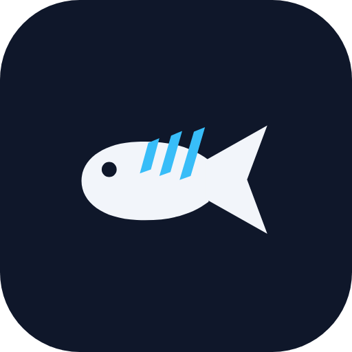
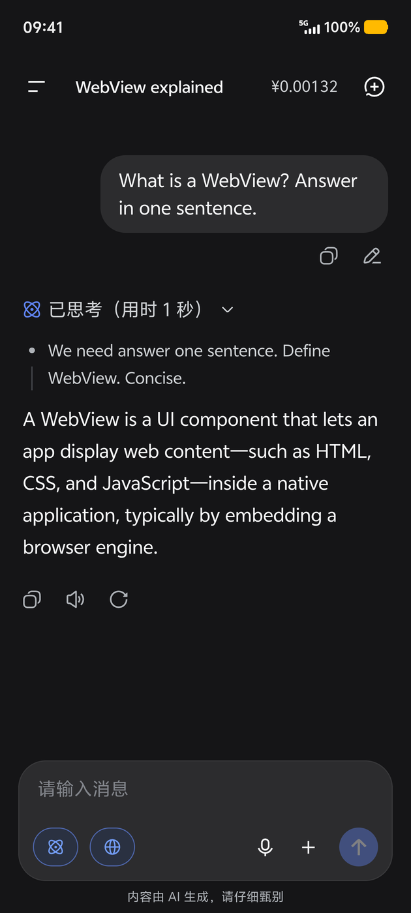
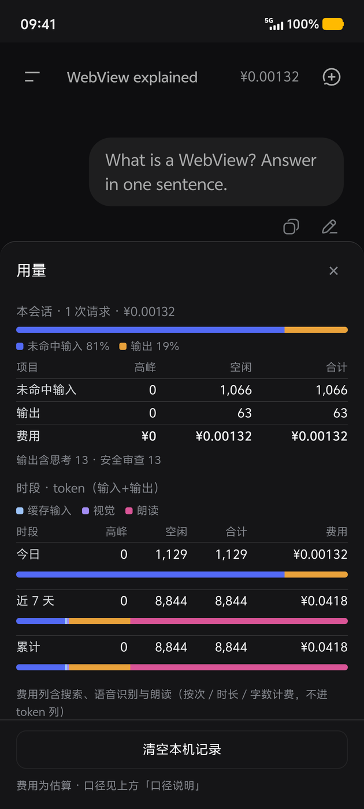

<h1 align="left">DS Lite</h1>



**DeepSeek's open-source web chat UI, wrapped in a 4 MB Android shell.**
Bring your own API key and you get the same conversation experience as the web app — plus a
**token usage & cost panel** the web version doesn't have.

[](LICENSE)
[](#quick-start)

> **Unofficial.** Not affiliated with or endorsed by DeepSeek. The web UI is
> [deepseek-ai/chat-demo](https://github.com/deepseek-ai/chat-demo) (MIT, © 2026 DeepSeek) and is
> redistributed with its license — see [THIRD_PARTY_NOTICES.md](THIRD_PARTY_NOTICES.md).

## Features

- Same UI as the web app: chat, thinking mode, web search, attachments, voice input, read-aloud,
  chat history import/export, light/dark theme.
- **Native extras the web can't do:** keyboard tracking the IME animation frame by frame, an image
  viewer with crop (drag corners/edges, rotate, reset), a batched gallery attachment sheet with
  multi-select, sane back-button handling, downloads to `Download/DeepSeek/`.
- **Token usage & cost panel:** per-session cost in the header, breakdown table by peak/off-peak,
  cache hits, vision tokens split out of the input, plus per-call ASR/TTS accounting.
  Records stay on device (`localStorage`).

## Screenshots

| Chat | Usage panel |
|:--:|:--:|
|  |  |

## Quick start

Requires Android 8.0 (API 26)+ and your own DeepSeek API key.
Grab `ds-lite-v1.4.5.apk` from [Releases](https://github.com/icechef/ds-lite/releases/latest) (debug-signed), or build it yourself below — then open **Settings**, paste your `sk-…` key and chat.

## Build

```bash
export JAVA_HOME=/path/to/jdk-17
export ANDROID_HOME=/path/to/android-sdk
cd android && ./gradlew assembleDebug
# android/app/build/outputs/apk/debug/app-debug.apk
```

## Notes

- No backend, no analytics, no account: requests go straight to `api.deepseek.com`.
- Costs are **estimates** (public price list × peak/off-peak window, no holiday calendar);
  document parsing is billed per page and isn't counted.
- Usage can only be recorded from requests made inside this app — the web UI drops `usage` before saving.
- No push/background service: closing the app stops it.

Technical write-up (resource mapping, keyboard insets, usage accounting) lives in
[docs/HOW-IT-WORKS.md](docs/HOW-IT-WORKS.md) (Chinese).

## License

MIT for the shell code ([LICENSE](LICENSE)); the bundled web build keeps its upstream MIT license
(`android/app/src/main/assets/web/LICENSE`).

<sub>中文: [README.md](README.md)</sub>
