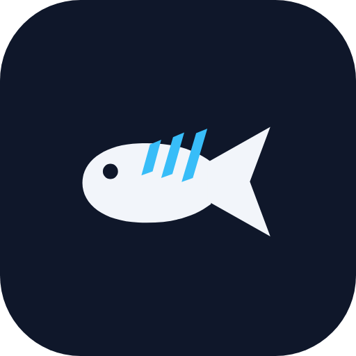
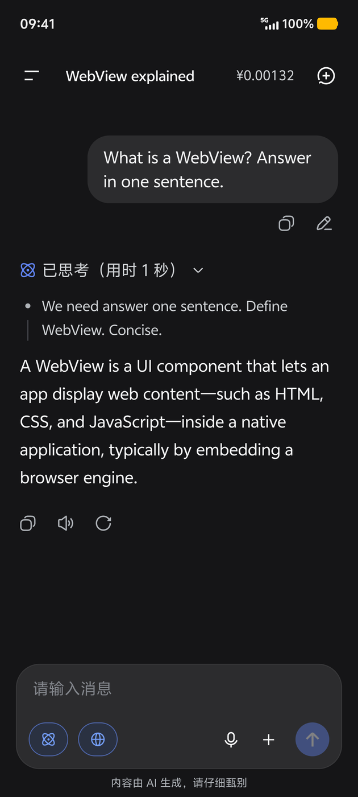
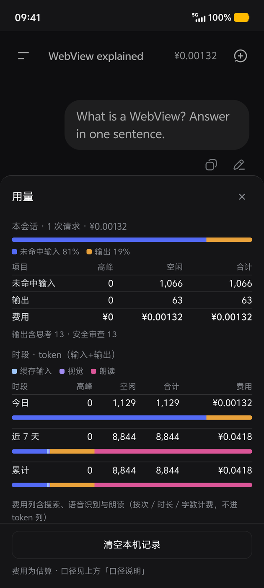
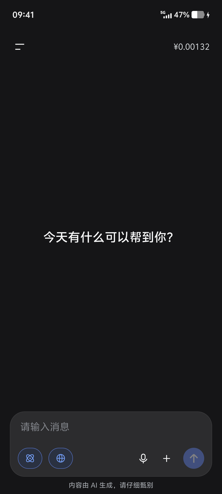
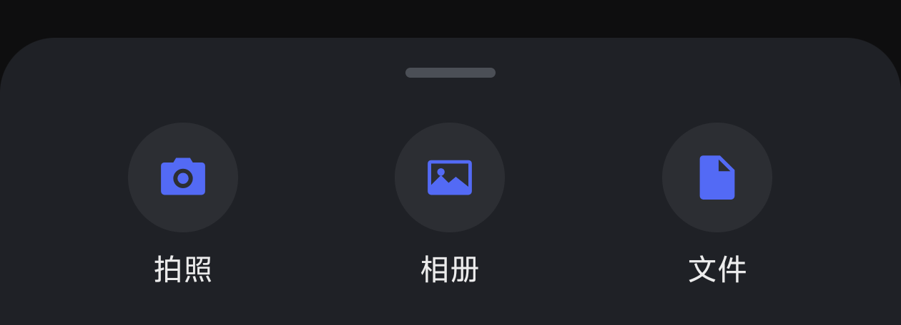

<h1 align="left">DS Lite</h1>



**把 DeepSeek 官方开源的网页版对话界面装进一个 4 MB 的安卓壳。**
填上自己的 API Key，得到的就是和网页版一模一样的对话客户端——外加一个网页端没有的 **Token 用量 / 费用面板**。

[](LICENSE)
[](#快速开始)
[](#从源码构建)
[](THIRD_PARTY_NOTICES.md)

> **非官方项目。** 与 DeepSeek 无隶属或背书关系。网页界面版权归 DeepSeek，以 MIT 许可随包分发，
> 见 [THIRD_PARTY_NOTICES.md](THIRD_PARTY_NOTICES.md)。桌面名可在 `strings.xml` 的 `app_name` 自行修改。

## 为什么会有这个

DeepSeek 网页版开始限流之后，官方把对话界面开源成了
[chat-demo](https://github.com/deepseek-ai/chat-demo)（MIT，一个纯前端的全家桶 API 演示）。
它能直接在浏览器里跑，缺的只是一个安卓壳：`file://` 不是安全上下文（麦克风用不了、CORS 拿不到 key），
而有些事网页在 WebView 里根本做不到。这个仓库就是那层壳——**网页功能一个不少，原生侧补齐网页做不到的部分**。

## 它能做什么

**网页有的，这里都有**

- 对话、深度思考、智能搜索、多轮上下文，界面与网页版一致
- 语音输入（`getUserMedia` 录音 + 频谱）、朗读回复
- 图片 / 文档附件；聊天记录按官方 ZIP 格式导入导出
- 浅色 / 深色主题跟随系统

**网页做不到、由原生层补上的**

- **键盘逐帧跟随**：输入区跟着输入法动画一帧一帧上移，而不是先跳一下再对齐
- **图片查看与裁剪**：双指缩放、双击放大、四角与四边拖拽选区、旋转、还原；结果替换原附件
- **附件面板**：拍照 / 相册 / 文件 / 最近照片，缩略图分批解码不卡顿，最多 9 张多选
- **返回键**：先关浮层 → 再页面后退 → 首屏双击退出
- **导出落盘、剪贴板、外链、状态栏配色**：全部交给系统，不在壳里套娃

**网页端没有的**

- **Token 用量 / 费用面板**：标题栏常驻当前会话的估算费用，点开是分项表格 + 费用占比条——
  高峰 / 空闲分列、缓存命中单列、视觉 token 从输入里扣出来单列、语音与朗读按各自口径记。
  记录只存在本机 `localStorage`。

## 界面速览

| 对话 | 用量与费用面板 |
|:--:|:--:|
|  |  |

| 首页 | 附件面板 |
|:--:|:--:|
|  |  |

截图来自真机（Android 16 / 1260×2800，状态栏为演示模式）。

## 快速开始

| 项目 | 要求 |
|---|---|
| 系统版本 | Android 8.0（API 26）及以上 |
| 安装包大小 | 约 4 MB |
| 需要什么 | 自己的 DeepSeek API Key（[申请地址](https://platform.deepseek.com/api_keys)） |
| 需要 root 吗 | 不需要 |
| 需要后端吗 | 不需要：壳不含任何服务器，请求直接发往 `api.deepseek.com` |

1. 从 [Releases](https://github.com/icechef/ds-lite/releases/latest) 下载 `ds-lite-v1.4.5.apk` 安装
   （debug 签名，自用足够；想自己构建见下一节）。
2. 打开 App → 右上角 **Settings** → 填入 `sk-` 开头的 API Key。
3. 想导入以前的聊天：Settings → **Import chat history** → 选官方导出的 ZIP。
4. 语音输入第一次会申请麦克风权限，拒绝后可在系统设置里再开。

## 从源码构建

需要 JDK 17 + Android SDK（platform-34 / build-tools 34.0.0）。

```bash
export JAVA_HOME=/path/to/jdk-17
export ANDROID_HOME=/path/to/android-sdk   # 或写进 android/local.properties 的 sdk.dir
cd android
./gradlew assembleDebug                     # 没有 wrapper 时用本机 gradle 8.x
# 产物：android/app/build/outputs/apk/debug/app-debug.apk
```

网页资源是 `cdn.deepseek.com/chat-demo` 的构建产物，已随仓库打包；需要重新抓取时：

```bash
python tools/fetch_assets.py            # 重新抓取（含 88 个异步 chunk）
python tools/fetch_assets.py --verify   # 只校验 chunk map 与本地文件是否齐
```

## 权限说明

| 权限 | 用途 |
|---|---|
| 网络连接 | 访问 `api.deepseek.com` 完成对话；壳本身没有后端 |
| 麦克风 | 语音输入：网页用 `getUserMedia` 录音，需要授予 `AUDIO_CAPTURE` |
| 照片和视频 | 只在打开附件面板、显示「最近照片」时读取 |
| 存储 / 文件 | 通过系统文件选择器挑附件；导出聊天记录写入系统「下载/DeepSeek/」 |

没有账号体系、没有埋点、没有统计上报；用量记录只写在本机。

## 常见问题

**费用和官方后台账单为什么对不上？**
面板按官方价目表 × 峰谷时段估算：高峰等于北京时间工作日 9:00–12:00、14:00–18:00，但没有法定节假日表；
文档解析（¥1.5/千页）拿不到页数，只记「N 个（未计入）」。统一按「估算」看，别当账单用。

**历史消息有 token 数吗？**
没有。网页写 IndexedDB 时会把 `usage` 丢掉，所以只能从装上这个壳之后发出的请求开始计，历史消息无法回填。

**换手机、或者用网页版，记录会同步吗？**
不会。记录只在本机 `localStorage` 里，换设备就是新的账本。

**能换模型吗？**
网页版只带 `deepseek-flash`，这里保持一致。

**为什么每轮「输入」都很大？**
每轮请求的输入都包含完整对话历史，累计起来自然远大于对话本身的字数——这不是重复计费。

## 已知限制

- 没有原生推送 / 后台保活：关掉 App 就不会再跑（对话是请求-响应式的，本来也不需要常驻）。
- 返回键的「当前有没有浮层」是启发式判断：极少不吃 `Escape` 的弹窗需要手动点关闭。
- 导出几十 MB 的聊天记录会走 dataURL → 原生解码，比较吃内存。
- 只统计本 App 内的请求：网页版、其他设备、直接调 API 的用量都不在内。
- Release 里的是 **debug 签名**的 APK（自用足够）；自己构建出来的 debug 包与它同签名，可以覆盖升级。

## 技术细节

资源映射与虚拟域名、键盘逐帧跟随的分工、用量嗅探与计费口径，见
[docs/HOW-IT-WORKS.md](docs/HOW-IT-WORKS.md)。

## 致谢与许可

- **壳代码**（`MainActivity.kt`、`ImageInspector.kt`、`AttachmentSheet.kt`、`TempFilesProvider.kt`、
  `shim.js`、`usage.js`、`tools/`）：MIT，见 [LICENSE](LICENSE)。
- **网页界面**：[deepseek-ai/chat-demo](https://github.com/deepseek-ai/chat-demo)，MIT，
  Copyright (c) 2026 DeepSeek。上游要求分发时一并保留许可证，原文随包放在
  `android/app/src/main/assets/web/LICENSE`，汇总见 [THIRD_PARTY_NOTICES.md](THIRD_PARTY_NOTICES.md)。
- 无第三方运行期依赖：`android/app/build.gradle.kts` 的 `dependencies` 是空的。

<sub>English: [README.en.md](README.en.md)</sub>
